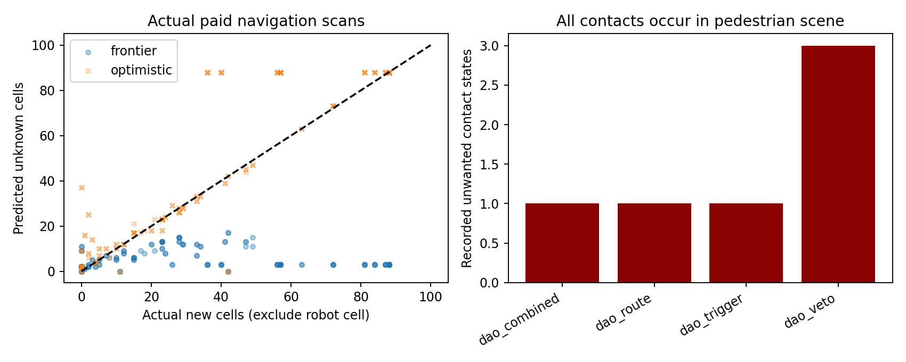
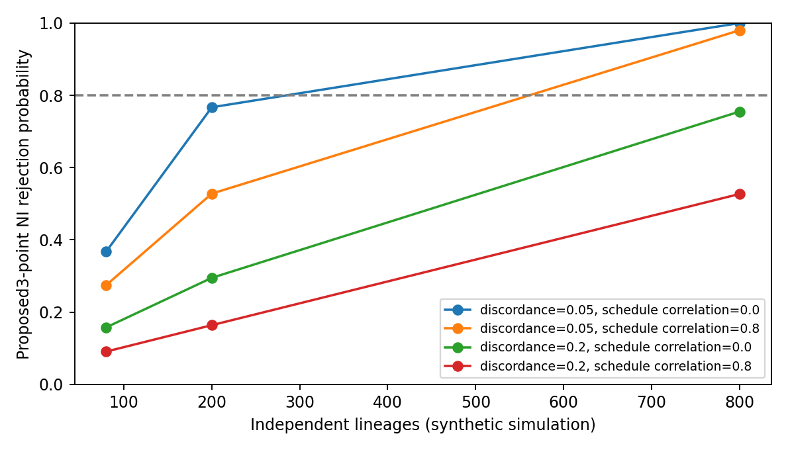

# DAO G1 integration and independent-study infrastructure report

**Engineering integration and diagnostics are complete. Safety acceptance failed
in the hand-defined pedestrian scene; independent efficacy and production pilot
readiness are NOT established.** No production pilot/development/sealed population
was generated/admitted/accessed, no reserved world was opened, no new full FIT72
screen ran, no real DAO winner was selected and no DAO threshold changed.

Base `d04db45472c7c28e91c0753f4271190c87bcc52a`, branch
`phase2/mujoco-proxy-pilot`, university-library Mac, existing Python3.12 `.venv`.
Source/scene freeze `82f0f2d`; versioned route-compatibility recovery `ecbd56d`;
TEST-generator connectivity correction and conservative statistics `eb02ab0`.
Full SHAs are in git and the completion ledger. Original DAO v1/CAA algorithms,
all previous result artifacts, original FIT stores and G1 assets are preserved.

## Execution actually performed

- Final integration/regression gate: **180 passed,0 failed**, including frozen
  DAO/CAA/cadence/G1/emergency tests and new integration/generator/admission/statistics.
- Separate versioned correction checks: **13 generator +5 statistical tests
  passed**. These are198 distinct passing cases across the final gates, not
  a claim of one198-test invocation.
- **48 completed engineering navigation episodes**,12 hand-defined scenes×4
  frozen DAO variants. The first36 were saved before a failure; the recovery
  executed only the missing12. One additional formal attempt failed partway
  through diagnostic preparation and has no fabricated completed trace.
- **120 actual61-ray fixture scans**,10/scene, separately authorized and accounted
  apart from all navigation-policy observations. Independent reconstruction
  checked all287 persisted actual readings (167 navigation +120 fixture).
- DAO-specific pre-freeze/recovery unit tests invoked the navigation wrapper6
  times:1 initial2-step metadata-packaging failure,1 successful2-step probe,
  two6-step probes and two24-step pedestrian regressions. They are separate
  from the48 published formal episodes. Other legacy test internals are not
  represented as new DAO experiments.
- Twelve explicitTEST generator payloads at seed101 were retained from v1;
  twelve corrected TEST:v1_1 payloads were generated after versioned source
  freeze. These24 files are engineering regressions, NOT pilot/dev/sealed
  lineages or a navigation cohort; none was evaluated for navigation efficacy.
- Synthetic analysis:80 lineage tables with two schedules and five artificial
  arms;24 completion coverage/power conditions×1000 repetitions,12 conditional
  cost conditions×200 repetitions/bootstrap200,10000 rare-contact repetitions,
  and12 conservative-bound conditions×1000 repetitions. No real candidate selection.

## Frozen policy integration and failures preserved

`dao_navigation_v1.py` adapts the original decide/refresh boundary without editing
`discovery_observation.py`. Constants, ternary memory, timestamps, fallback,
cap20 and all four request equations remain exact. The original evaluator's G1
planner, actual61-ray paid sensor, independent61-ray emergency sensing and
selected-action-only collision shield are reused through scoped callbacks.
Module bindings restore in finally; metadata explicitly says ENGINEERING_HAND_SCENE,
never an admitted Phase1.5 population. No FIT payload is generated or modified.

DAO-Route requires one additional public point-grid A* per decision. Its5-move
prefix uses public memory/goal/unknown semantics only, with no true geometry,
future schedules or unselected shield probes. The other three variants add no
scheduler plans. Diagnostic point planning on actual paid scans is separate;
Route reuses its current route. Predictions are computed before the reading,
including initial all-unknown memory, with no actual sensor at denied decisions.

The first formal process saved36 episodes/90 fixture scans, then stopped in the
pedestrian scene. A measured occupied memory cell at the current robot position
was permitted as a public point-planner start but rejected by frozen DAO's
optional-route validator. **The memory was not cleared using true pose.**
Separate `dao_navigation_compat_v1_1.py` and `run_dao_integration_v1_1.py` treat
that inadmissible public route as missing, invoking unchanged no-route semantics.
The same guard covers diagnostic routes. Regression tests preserve the occupied
cell and compare directly with frozen DAO supplied an empty route. The v1 files,
failure traceback and36 saved episodes remain unchanged. See
[route compatibility recovery](dao_integration_v1_1_recovery.md).

A separate initial unit failure arose at legacy row packaging due to missing
engineering identity metadata; it is recorded in preparation_failures.json.
A report-only list-denominator error was preserved under analysis_report_failure_1
and repaired without any new sensor call, episode or simulation. No failure
was reinterpreted as a successful original run or silently discarded.

## Hand-defined navigation findings, including contacts

These deliberately small scenes exercise corridor, unknown obstacle, room entry,
turn, repeated view, explored surroundings, known staleness, persistent addition/
removal, temporary pedestrian crossing, off-route discovery and important
low-discovery views. The two separating-wall scenes may fail by construction.
They are not independent efficacy samples and have no baseline comparison matrix.

| Variant | Completed episodes | Goals | Paid scans | Emergency scans | Selected shield calls | Unwanted contact pairs / states | Age5 requests suppressed |
|---|---:|---:|---:|---:|---:|---:|---:|
| DAO-Veto |12|10|37|141|87|117 /3|9|
| DAO-Trigger |12|10|47|143|93|39 /1|0|
| DAO-Route |12|10|38|137|87|39 /1|0|
| DAO-Combined |12|10|45|143|93|39 /1|5|

All contacts occur in the pedestrian scene and are pedestrian-contact pairs;
wall/object/self/unwanted-floor counts are zero. Pair counts are sums of
geometry contact pairs across recorded states, not117 distinct collisions or
people. Veto has3 contact states; each other variant has1. Emergency interventions
are4 for Veto and2 each for the others. Original safety code/geometry is unchanged,
but that fact does not guarantee contact-free behavior in new scenes. Available
post-action traces do not isolate a causal contribution of exogenous pedestrian
motion versus scheduling/action timing; no unseen pre-action measurement is inferred.

**Do not proceed to a production pilot on a claim of safety acceptance.** A
separately scoped safety mechanism audit is needed; this task did not alter
DAO thresholds, pedestrian trajectories, the G1 planner or shield to remove
these negative outcomes. The original owner's zero-contact objective fails
on these engineering scenes for all four variants. Neither fewer scans nor
10/12 goals qualifies as an independent improvement.

The same-state veto mechanism does activate (9 Veto,5 Combined requests), unlike
the prior48 purely public geometric fixtures where it activated0. This does NOT
change the prior finding: these are different scenes with actual sensor histories.
Trigger and Combined no longer have identical total paid counts (47 vs45), but
no superiority follows. Twenty-three actual fallback scans occurred;3 had no
new cells, changed-known cells OR stale-known verifications. They can still
verify fresh known space; absence of these immediate changes is not proof of
causal uselessness. Invisible old cells can keep requesting; no budget20 violation
or hidden refresh was found. No outcome-dependent threshold optimization followed.

Persisted completed-navigation workload is10187 paid rays +34404 emergency rays
=44591 combined rays. Fixture diagnostics add7320 rays on a separate ledger.
These totals exclude incomplete attempts and unit-test sensor calls, whose lost
prefix accounting is not fabricated. Legacy metric-row sensor-ray fields can
be zero because its timed provider closure lacks last_stats; use independently
measured actual_calls, memory_rays and emergency_rays, not those legacy placeholders.

## Predicted versus actual discovery

Each scan saves optimistic/frontier footprint cells, predicted unknown cells,
actual observed cells/values, actual first readings, known endpoint changes,
stale-known verification, public route prefix and route-relevant discovery.
The independent scalar reference replays predictions from RECONSTRUCTED public
memory before every scan. It exactly matches all287 raster footprints and
unknown sets. Actual values alone reconstruct timestamps and last-write memory;
no hidden occupancy or future observation is used in scoring.

For comparable precision/recall both predicted and actual new-cell sets exclude
the robot cell; full actual readings remain available. Zero-denominator ratios
are null and omitted from macro means, with their counts retained. Missing
public route is explicitly marked/conventionally contributes0 to the frozen
route count; this is not evidence of zero navigation importance.

| Role / estimate | Scans | Mean signed error | Mean absolute error | Macro precision | Macro recall |
|---|---:|---:|---:|---:|---:|
| Navigation / frontier |167|-24.976|26.293|0.751|0.327|
| Navigation / optimistic |167|5.940|7.784|0.632|0.937|
| Fixture / frontier |120|-12.058|12.058|1.000|0.192|
| Fixture / optimistic |120|3.008|3.142|0.788|0.949|

Navigation has7 undefined precision and39 undefined recall observations per
estimate; fixtures72 and70 respectively. Macro means have different contributing
sets and correlated readings/variants, so they are not independent calibration
estimates. Frontier sharply undercounts useful deeper visibility; optimistic
prediction overcounts through unknown or3D occlusion. Neither is a certified
physical lower/upper bound, calibrated information gain or proof of navigation
relevance. Precision1 in supported fixture predictions cannot be generalized.
No alternative visibility model or new DAO variant was selected from this data.



## Computation, reproducibility and resource limits

Route made137 extra public point plans, totaling9.378ms (about0.0685ms/call).
Scheduler totals over12 episodes were Veto360.403ms, Trigger376.767ms,
Route376.049ms and Combined379.793ms, including Route's extra planning.
Mean per-decision scheduler times are approximately2.56/2.63/2.74/2.66ms.
Stored episode-wall sums are1.613/1.423/1.314/1.379s in the same order; these
include model building, evaluator work and diagnostics. These are small fixed-
order15x15 engineering scenes on one Mac, not CPU rankings or extrapolated
independent-cohort runtime guarantees. Peak process RSS was not instrumented.
Pilot protocol requires measured resource/checkpoint logs before production use.

Independent counters equal authorized scan counts, selected action checks and
emergency scans. At every captured frame, memory equals only paid last-write
updates. No extra/unselected shield calls, scan-cap excess or free inference
was found. Original2907 checkpoint/receipt pairs,836 protected files,928 CAA
artifacts,37 prior DAO artifacts and58 G1 assets pass read-only verification.
Both initial/recovery source bindings and identical scene JSON are preserved.
The final recursive manifest and committed-byte check include failure evidence.

## Generator and admission infrastructure

[Implementation/design decisions](dao_generator_admission_v1.md) specify the
exact TEST schema, HMAC streams, four lattice/tree/loop/room/mixed constructions,
25/33/41 dimensions,0.75m scale, start/goal/heading, movable objects, timed
add/remove/relocate events, paired exogenous pedestrian phases, structural
revisit/discovery treatments and through-event conservative G1 certificates.
Production functions/streams/admission explicitly reject production namespaces.

The conservative certificate biases accepted layouts toward width3; all12
retained TEST outputs accepted width3. Rooms use4–6-cell sides, moving proxies
use discrete out-and-back trajectories and approximate.25/.5/.75 speeds;
those deviations from earlier broad proposals are documented choices requiring
approval. Recorded single nominal speed is not a per-pedestrian calibrated
speed estimate; actual cyclic speeds can be0.727 rather than0.75. Structural
BFS/DFS treatment is not a guarantee of actual robot revisit frequency.

Postprocessing found4/12 original occluded TEST layouts disconnected outside
the reserved start/goal path. A valid path certificate did not establish full
layout connectivity. Preserve those results as failed validation. Separate
`dao_generator_v1_1.py` rejects an island that disconnects free space and checks
whole-layout connectivity. The12 corrected TEST outputs are all connected:
8 islands applied,4 rejected and explicitly missing that intended treatment.
No original file/result was overwritten, no production population was created.
See [generator correction](dao_generator_v1_1_recovery.md). More coverage and
approved generator distributions remain necessary; these12 are not a pilot.

Admission implements occupancy-only and endpoint-aware8-transform canonical
hashes with empty-padding normalization; compressed corridor graph signatures;
WL prefilter followed by exact labeled multigraph isomorphism; occupancy
Jaccard and bounded small-graph edit checks; and unresolved-case quarantine.
Tests show rotations/reflections/translations and changed endpoints cannot
hide an exact structural copy, and equal WL hashes need not prove isomorphism.
Exclusive hash-chained generation/admission logs and salted inventory commitments
are implemented/tested. Their hashes are NOT independent access control.

Graph matching bounds and dense-room graphs can quarantine realistic layouts;
scalable complete admission is not established. Authorized prior opaque
signatures are unavailable, so production admission is INCOMPLETE. The practical
custodian/gated-runner/ACL/key/read-log workflow is designed but NOT established.
No protected reserved store was opened to construct missing signatures.

## Statistics infrastructure and actual validation failures

Synthetic tables validate paired goal differences, superiority/NI flags,
whole-lineage bootstrap, exact rare-contact upper bounds, paid/combined sensing,
common-success conditional steps/distance, missing denominators, failure-
penalized sensitivity, Holm correction, fixed-sequence gates and development
selection/confirmation. Both schedules stay together. Sealed inputs are
rejected by selection APIs. Artificial candidate names in unit tables test
these functions only; no real DAO winner was chosen.

The original owner's descriptive target (zero contacts and more completion,
or equal completion/fewer paid scans) is distinct from PROPOSED3-point NI,
10% joint benefit and compute margins. None of those scientific thresholds
or the sealed size is approved by this implementation.

Normal-approximate completion intervals achieved empirical coverage0.934–0.968
across24 conditions. At the proposed NI null boundary(loss.03), rejection
frequencies ranged0.020–0.058, exceeding nominal one-sided.025 in some scenarios.
At n200 and true loss0, proposed NI power ranged0.164–0.767 depending on
schedule correlation/discordance. Thus200 is not justified by these results.
Conditional-cost percentile bootstrap coverage ranged0.880–0.955; at the10%
benefit null boundary, rejection rates were0.025–0.080 (200 repetitions each).
Monte Carlo SE is up to0.0158 for1000 repeats and0.0354 for200; these simulations
are diagnostics, not a universal guarantee. Rare-contact upper-bound coverage
was1.0 in10000 binomial n200/risk.01 repeats, consistent with conservatism.

**The approximate inferential pipeline is NOT validated for sealed efficacy
claims.** Preserve it and its failed coverage evidence. Optional versioned
`dao_statistical_bounds_v1_1.py` adds finite-sample Hoeffding bounds using
independent lineage means and declared H80/cap20 metric ranges. Conditional
movement uses an unconditional common-success numerator with an explicitly
positive common-success probability bound, avoiding a fabricated denominator.
It does not claim validated compute inference, joint power or final approval.

Five targeted tests pass. Twelve synthetic conservative scenarios all cover
the true completion difference in1000/1000 repeats, with no NI null-boundary
rejections observed. This is consistent with the analytic bound under its
independence assumptions, not proof from simulations alone. Conservatism is
expensive: at n10000, loss0/correlation.8, simulated NI power is0.903 for
 discordance.05 and0.749 for.2. These are synthetic arrays, NOT10000 generated
navigation worlds; no sealed size is chosen. Affordable alternatives include
estimation-only independent studies with candid intervals, or a separately
preregistered/calibrated inferential model and controlled sequential design.
Never widen the NI margin or stop on favorable sealed outcomes.



## Exact next pilot plan and remaining approvals

[Proposed pilot](dao_pilot_v1_protocol.md):24 lineages, six/family, two correlated
schedules,12 arms (Periodic4/5, Age4/5/6, CAA-Fast/Slow/Full, four frozen DAO),
**576 episodes** at horizon80/cap20. Predeclared allocation, admission, actual
sensor diagnostics, resource checks, stop rules and all comparison fields are
specified. Max workload11520 paid calls and46080 emergency calls; no winner
selection or efficacy claim is permitted.80 development lineages and a future
power-justified sealed partition stay separate and ungenerated.

Before any production pilot: owner approval of exact schema/distribution
changes,24-slot/12-arm workload/start-heading handling, scalable duplicate
admission and prior opaque signatures, independently enforced custody, safety
review of the actual contact finding, analysis method/coverage and scientific
margins, development selection rules and a justified sample-size procedure.
These are genuine next-experiment blockers, not a request to continue the
current engineering task into population generation. **Stop here.** No policy
threshold tuning, FIT72 screen, population generation/access or DAO promotion.

## Artifacts and commands actually executed

Output root `results/phase2_mujoco/dao_integration_v1/` contains original/recovery
bindings, prepared tests/scenes, failed engineering run,48 completed episode
ledgers,12 fixture ledgers, TEST-only generation/admission logs, synthetic tables/
power simulations, versioned corrections and analysis/integrity figures.
Outputs refuse overwrite; all failures and source versions remain reviewable.

```sh
.venv/bin/python scripts/run_dao_integration_v1.py prepare
# Commit prospective source and scenes.
.venv/bin/python scripts/run_dao_integration_v1.py formal
.venv/bin/python scripts/check_dao_infrastructure_v1.py
# Preserve partial failure; commit v1.1 compatibility and passing gate.
.venv/bin/python scripts/run_dao_integration_v1_1.py prepare
.venv/bin/python scripts/run_dao_integration_v1_1.py formal
MPLCONFIGDIR=/private/tmp/dao-matplotlib .venv/bin/python scripts/report_dao_integration_v1.py
# Commit TEST connectivity/bounds corrections before their formal checks.
.venv/bin/python scripts/check_dao_corrections_v1_1.py
```

Full executed pytest commands and JUnit files are saved under prepared/,
prepared_v1_1/ and generator_v1_1_checks/. This task supplies engineering evidence,
working interfaces and a concrete next-study plan; it does not establish the
intended joint navigation/sensing improvement or independent safety acceptance.
