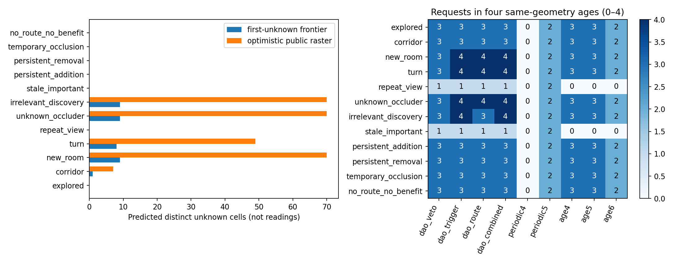
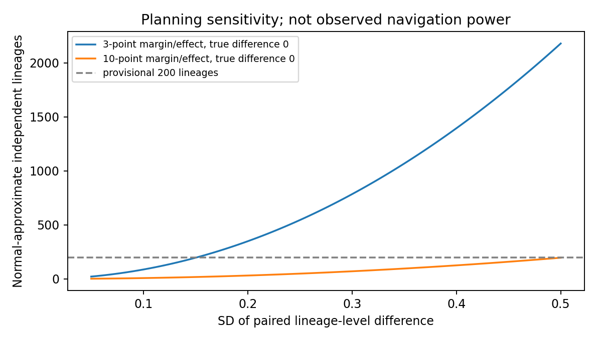

# Discovery-aware Observation (DAO) v1 research report

**Completed: saved-evidence discovery audit, four initial DAO implementations,
unit/regression tests, frozen synthetic mechanism validation and an independent
navigation/statistical proposal. Navigation superiority is NOT established.**
No new FIT72 policy screen, pilot/development/sealed population generation,
admission or access, or reserved-world access occurred.

Starting commit: `5cb40fce42e8791b1406245684be5d0df0964b93`.
Initial prospective policy/geometry/fixture freeze:
`11e6568a85ea837696923e3ec98ee541d3b016e4`.
Serialization-only harness recovery/rebinding before replacement formal run:
`cb72198bde78d6050a99f810cbfdd51b2add5335`.
Branch: `phase2/mujoco-proxy-pilot`; university-library Mac; existing Python3.12
`.venv`. Original CAA source, thresholds and result artifacts remain unchanged.

## Why investigate discovery

Age excludes never-observed cells from its local stale fraction. A robot may
face a new room/turn with substantial unknown information yet have insufficient
old known cells to request a scan. Conversely, local stale cells can lie behind
the120-degree FOV or behind remembered obstacles. Discovery, known-cell
verification, changed-known readings, task relevance and redundancy are distinct.
Verification without a map/action change can still be valuable; unchanged-only
readings are never automatically labeled useless.

The prior CAA result remains66/72 goals,768 scans versus Age5's770, zero contacts,
with all savings in one maze/schedule, scan-difference CI including zero and
slightly increased common-success distance. It is frozen, not upgraded into
independent evidence by this new analysis. RDAO/EVI/view/route/motion reports
likewise did not establish the desired joint independent dominance. Review
input hashes and the closure decision are recorded in `review_record.json`.

## Existing evidence: discovery is common, not proven causal

The [retrospective analysis](dao_discovery_retrospective.md) processes360 unique
saved episodes,72 per Age4/Age5/CAA-Fast/Slow/Full, enriched by144 matching
Age4/Age5 frame archives. Smoke replications are inventoried, not pooled.
There are3926 scan records including360 initial scans,3566 noninitial scans.

| Arm | Noninitial scans | With new cells | With changed-known | Unchanged-only | New cells median / IQR |
|---|---:|---:|---:|---:|---|
| Age4 |778|694|21|83|11 / 4–19|
| Age5 |698|630|30|64|11 / 4–20|
| CAA-Fast |696|630|30|62|11 / 4–20|
| CAA-Slow |698|630|30|64|11 / 4–20|
| CAA-Full |696|630|30|62|11 / 4–20|

Discovery and changed-known scan categories overlap. Counts of new cells do
not estimate information bits or navigation benefit. All scan positions,
pre-action headings, intervals, progress, subsequent public trace actions,
same-step and next-step blocks are retained in CSV.

Exact saved before/after maps support1476 Age4/Age5 scans. Public point-grid
nominal routes at the same pre-action pose change319/298 times respectively;
first nominal moves change118/146 times. Newly observed cells within Manhattan1
of the next5 nominal moves total3105/3060. The actual G1 action planner is a
different clearance-aware model; these are offline public-route proxies.

CAA's2090 noninitial records have scalar scan content but no saved per-cell
rasters. Their exact discovery positions and corresponding route changes are
MISSING, not inferred or filled by unauthorized new replays. The episode/scan
CSVs also distinguish ordinary temporal action change from any causal effect.
Successful episodes have more discovery per scan, but motion opens new space
while blocked robots repeat views. Duration, survival, layout, cap exhaustion
and policy-conditioned exploration confound all these associations. Two
schedules per each of36 reused mazes are correlated. No causal claim, supervised
fit or threshold selection follows from this audit.

## DAO mathematics and implementation

The [frozen protocol](dao_protocol.md) gives exact equations, priorities,
ties, constants and complexity. The new implementation is
`src/spatial_memory/discovery_observation.py`; the independent scalar checker
is `discovery_reference.py`. Legacy scheduling/sensor/planner code is unedited.

Public-memory arithmetic traces61 angular hypotheses using the existing
sampled raster convention, range6m, scale0.75m and120-degree FOV. Optimistic
rays stop at remembered occupied cells. Frontier rays stop additionally at
the first unknown cell, including it. Both union cells and exclude the current
robot cell. These are predicted footprints, NOT actual readings. Frontier is
a subset of optimistic in the raster model, not a proven lower physical bound.
Unknown occluders, 3D geometry, projection and sensor-site offset remain errors.

For footprint F: D counts unknown cells; V counts known cells last observed
at least5 steps ago; Q is their stale fraction among known footprint cells.
D_R counts discovered candidates within Manhattan1 of a supplied public route
prefix of5 moves. No route gives D_R=0. No scheduler A* or counterfactual plan
is invoked. No changed-known occupancy can be predicted as an actual detection.

Let A be the original radius3/fraction0.5 Age5 request; H=(D>=5),
W=(V>=3 OR nonempty-known Q>=0.5), E=(gap>=3 AND H), E_R=E AND D_R>0.
B is any local known cell at least10 steps old. At positive decision times:

| Variant | Request before finite cap |
|---|---|
| DAO-Veto | B OR (A AND (H OR W)) |
| DAO-Trigger | B OR A OR E |
| DAO-Route | B OR A OR E_R |
| DAO-Combined | B OR (A AND (H OR W)) OR E |

B supplies a bounded opportunity to revisit local known stale information,
even if its local fraction is small. It cannot guarantee visibility or change
detection and can repeatedly request invisible old cells until cap exhaustion.
Unknown outputs never reset timestamps or rewrite occupancy. Only actual
current grants authorize refresh; empty readings still consume paid budget.
Initial-inclusive cap20 is enforced. Current context must be refreshed before
each increasing decision; no hidden world or future schedule is consumed.

Five cells, three supporting verifications, half-interval cooldown3 and doubled
fallback10 are interpretable prospective engineering assumptions, NOT optimized
FIT values or calibrated utility prices. They remain unchanged after results.
Same-state inclusions between variants do not imply episode scan-count ordering.

DAO is not merely Route-Rescue renamed: it explicitly measures unknown-cell
acquisition independently of Age requests, separates stale verification,
uses a first-unknown visibility model and isolates route restriction of an
early discovery trigger. It does not use old occupied route-neighbor rescue,
no-route events, EVI values, semantic inference or topology scores. Novelty
and useful navigation behavior remain open research questions.

## Actual checks and formal execution

Final focused gate: **138 tests passed,0 failed**, including29 DAO policy test
cases plus1 serialization regression and108 existing CAA/cadence/G1/emergency/
EVI tests. Independent checks include160 seeded random public states, exact
legacy optimistic footprint parity, scalar count reference and analytic
narrow-FOV/unknown/occupied ray certificates. Tests cover authorization,
monotonicity, unknown/empty updates, persistent endpoint changes, stale fallback,
route restriction, deterministic replay and invalid bounded inputs.

48 hand-defined public states (12 families × ages3/5/9/10) were committed
before the first formal invocation. The initial process failed at JSON output
because a NumPy int64 count was not serializable. Its zero-byte output and
original binding/correctness records are preserved. No interpretable formal
PASS is claimed for that invocation. The repair affects ONLY harness scalar
serialization and adds a regression; policy, geometry, reference and fixture
hashes are unchanged. See [recovery record](dao_serialization_recovery.md).
The revised harness/binding was committed BEFORE the replacement execution.

The replacement completed **48/48 states,432 same-state rule decisions and432
controller authorization/cap contracts**, with no recorded assertion failures.
A contract exercises20 decisions, so these are8640 engineering controller
decisions, NOT8640 navigation episodes. Post-run verification independently
rechecks432 stored scalar count rows and exercises all four DAO controllers
through initial-inclusive cap20 with19 noninitial grants and later denials.
No MuJoCo scene, physical raycast, action shield or navigation episode is run.
In total:2 formal process invocations,1 incomplete serialization output,
1 completed formal suite. No threshold/fixture iteration followed outcomes.

## Synthetic findings, including negative findings

| Public geometry | Frontier predicted new | Optimistic predicted new | Frontier route-relevant new |
|---|---:|---:|---:|
| Fully explored |0|0|0|
| Unexplored narrow corridor |1|7|1|
| Entry to room |9|70|3|
| Turn |8|49|3|
| High discovery away from route |9|70|0|

Room and turn states authorize discovery-triggered scans before the Age5
anchor. Route gating suppresses the off-route discovery trigger in the
hand-defined irrelevant-region state. A hypothetical unknown occluder removes
7 optimistic cells per age (28 across4 states) in a separate2D evaluator
calculation; its identity is never input to the controller. This is not
sensor calibration or a real-world occlusion test.

| Rule | Requests among48 snapshots | Requests with A false | Suppressed Age5 requests |
|---|---:|---:|---:|
| DAO-Veto |32|2|0|
| DAO-Trigger |36|6|0|
| DAO-Route |35|5|0|
| DAO-Combined |36|6|0|
| Age5 |30|0|0|

The two Veto requests outside A arise from the fallback. **The48 geometric
fixtures do not activate the veto itself**; pure unit states test its Boolean
behavior, but this formal suite does not demonstrate a geometry-supported
veto benefit. Combined and Trigger have identical requests here. This is a
coverage/behavior limitation, not a reason to add favorable fixtures after
outcomes. The narrow corridor's frontier count1 fails the frozen5-cell trigger,
illustrating conservative underprediction of deeper discovery. Fully explored
states still request stale verification; discovery-awareness does not imply
safe elimination of these scans. Low-discovery stale states request at10 via
fallback, even when the original Age fraction stays below threshold.

Fixed controls produce Periodic4=0, Periodic5=24, Age4=30, Age5=30 and Age6=20
requests at the48 snapshots. Periodic4's zero is because selected ages3/5/9/10
contain no multiple of4, NOT because the controller never scans. Continuous
controller contracts and unit tests exercise actual clock ticks. Snapshot
counts are mechanism diagnostics, not comparable episode sensing costs or a
winner-selection criterion. The JSON `fallback_requests`/`earlier_than_anchor`
fields denote overlap with state predicates; for fixed controls they do not
attribute causality to DAO fallback/trigger mechanisms.

There is no navigation completion, unwanted-contact performance, movement
cost improvement, paid/emergency sensing reduction, independent superiority
or calibrated information-gain result for DAO in this task. The intended
meaningful joint improvement has not yet been demonstrated.



## Computation and preservation evidence

At most4096 map cells,61 rays ×81 samples=4941 sample visits, and a supplied
5-move prefix bound scoring. Assessment including input validation is
O(N+4941+5|F|), refresh O(N), working memory O(N+|F|), plus O(T) retained logs.
Both footprints share one arithmetic traversal. Extra scheduler A* and actual
sensor calls are zero. The formal suite hits the4941 bound without exceeding it.

Same-run assessment time across48 states: median3.482ms,95th percentile4.480ms,
range0.373–10.205ms. Measured formal suite elapsed27.407s includes reference checking,
432 controller contracts and output, not navigation runtime. The fixed-control
harness shares geometry diagnostics, so this is not a native baseline CPU
comparison. DAO episode wall-time overhead remains unmeasured; no cross-Mac
speedup is asserted. Resource bounds do not prove acceptable real-time cost.

Read-only integrity verification passes all2907 original checkpoint/receipt
pairs (identity, payload digest, receipt/run/sequence matching),836 protected
files,928 CAA artifacts,25 original CAA bound files and58 G1 assets. All prior
results/FIT stores remain unchanged. No new input transfer is needed. Source
bindings and per-stage/final recursive SHA256 manifests preserve reproducibility;
DAO CSV bytes explicitly bypass automatic newline conversion.

G1's original kinematic-root planner/model, actual61-ray paid memory sensor,
independent emergency safety, selected-only collision shield and ordinary
ternary last-write memory were not edited. Synthetic contract conformance
is not proof of an integrated navigation implementation or physical safety.
A DAO navigation adapter is deliberately not activated in this task.

## Concrete next independent experiment, subject to approval

The [prospective independent protocol](dao_independent_navigation_protocol.md)
and updated [cohort proposal](independent_cohort_proposal.md) specify four
layout families;25/33/41-cell dimensions; independent persistent changes and
exogenous paired pedestrian schedules; discovery/revisit/occlusion strata;
partitioned HMAC streams; exact dihedral hashes, graph-isomorphism and near-
duplicate quarantine checks; and an independent custodian with read logs.
No production generator or navigation population was created in this task.

24 pilot lineages×2 schedules are engineering/coverage only;80 development
lineages×2 support preregistered selection40/confirmation40. One candidate is
chosen without using sealed outcomes and may fail qualification; no switching
after confirmation. Proposed sealed controls include Periodic4/5, Age4/5/6,
CAA-Fast/Slow/Full, plus that one DAO candidate,9 arms total. Policy authors
must not access sealed worlds before source/matrix/analysis freeze.

**200 sealed lineages are provisional, not automatically adequate.** For
one-sided alpha.025,80% power, true completion difference0 and3-point NI margin,
normal planning requires2181 lineages at paired-lineage SD.50,349 at.20,197
at.15, or88 at.10.200 needs SD approximately<=.1514 under these assumptions.
A10-point superiority calculation does not establish3-point NI power. True
loss1 point makes the required size2.25 times larger. Joint cost benefits,
completion-dependent navigation subsets and rare contacts need separate
power/coverage simulations. Zero contact lineages in200 gives a one-sided95%
upper population risk near1.49%, not proof of zero risk. Numerical assumptions
and a primary statistical-design source are linked in the prospective protocol;
these are planning calculations, not results on a generated cohort.

Proposed gates prioritize no contact increase and completion NI, then at least
10% benefits in combined rays, paid scans and common-success steps/distance,
with prospective compute tolerances. These meaningful benefit/margin choices
need owner scientific approval. Maze clusters retain both schedules; report
rescues AND harms, all negative outcomes, conditional-denominator caveats and
all strong-control comparisons with prespecified multiplicity handling.

Approvals still required BEFORE the next navigation work: generator schema/
distributions and admission rules, pilot/dev scope, power-justified sealed n,
scientific margins/metrics and analysis validation, custodian/access mechanism,
development selection rules, and final source/candidate/matrix freeze. This
report requests no permission to expand scope automatically. **Stop here.**

## Reproduction and artifacts

Current outputs refuse overwrite. Commands actually used:

```sh
MPLCONFIGDIR=/private/tmp/dao-matplotlib .venv/bin/python scripts/analyze_dao_discovery.py
.venv/bin/python scripts/run_dao_synthetic.py prepare
# Commit prospective files before formal. See preserved serialization recovery.
MPLCONFIGDIR=/private/tmp/dao-matplotlib .venv/bin/python scripts/run_dao_synthetic.py formal
MPLCONFIGDIR=/private/tmp/dao-matplotlib .venv/bin/python scripts/report_dao.py
.venv/bin/python scripts/verify_dao_integrity.py
.venv/bin/python scripts/check_dao_artifacts.py
```

The current full directory is immutable evidence: do not delete it to rerun.
A future engineering replication needs a separately versioned output root and
prospective binding, with the initial failure/recovery retained in this v1.
Formal source/fixture changes, new algorithm iterations, navigation screens
or new population generation require their own authorized protocol.

- `retrospective/`: scan/episode ledgers, missingness, distribution plot, source hashes.
- `prepared/`, `protocol_binding.json`: final138-test gate and exact48 fixtures.
- `synthetic/`:432 decisions, summary, full source binding and manifest.
- `analysis/`: mechanism plot, planning table/plot, environment metadata.
- `verification/`: independent scalar-row/cap20/original-data checks.
- Superseded labeling draft, original prepared binding and failed serialization
  output are retained explicitly; they are not independent efficacy replications.


