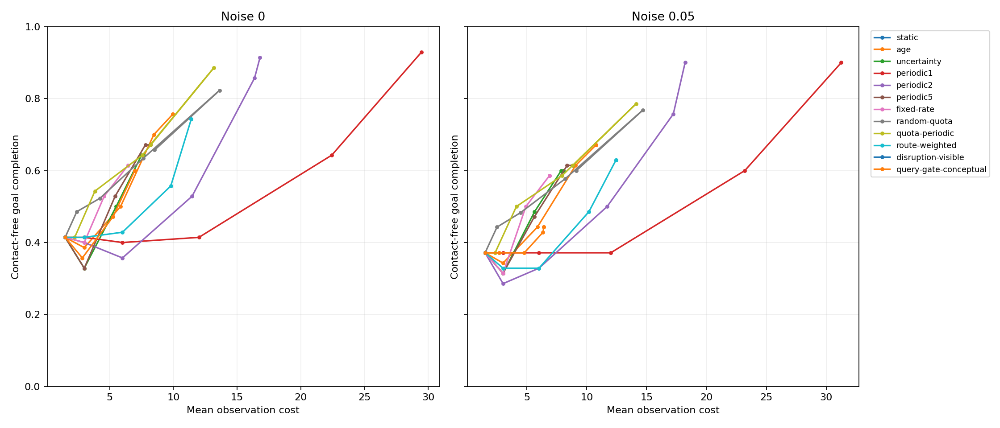

# Phase 1.4C locked development assessment

All **13,440 episodes** are complete, with no missing or duplicate records. The
independent verifier checked every trace checksum and **295,680** reconstructed
metric/counter values. The locked disruption-visible policy did not establish
superiority: it requested no additional observations and matched Static throughout
its 840 paired assessment conditions.

## Findings

The confirmatory contact-free completion difference at cap 4, noise 0 is
**-1.43 percentage points** (disruption-visible 41.43%, route-weighted 42.86%).
The global layout-cluster percentile 95% interval is **[-10.05, 8.10] percentage
points**. It includes zero and the prespecified +5-point practical threshold.
The practical-benefit criterion is therefore inconclusive; this is neither
evidence of superiority nor proof of equivalence or of no possible benefit.

The bootstrap accepted 10,000 draws in 10,011 attempts; 11 draws lacked a family
and were redrawn. The primary bootstrap distribution has 6,739 distinct values
and is not degenerate. Leave-one-family-out point differences range from -8.33
to +11.67 points. Family differences are +30 points in critical, -80 in outdated,
+40 in reopen and zero in the other four families. The pooled point estimate
thus conceals substantial family dependence.

Descriptive cap-4, noise-0 results (70 environments; random-quota averages its
five replicates within each environment):

| Method | Contact-free completion | Goal completion | Mean observations |
| --- | ---: | ---: | ---: |
| quota-periodic | 54.29% | 62.86% | 2.56 |
| fixed-rate | 52.86% | 58.57% | 3.04 |
| periodic5 | 52.86% | 61.43% | 3.61 |
| random-quota | 52.29% | 61.71% | 2.82 |
| age | 50.00% | 55.71% | 3.90 |
| uncertainty | 50.00% | 58.57% | 3.67 |
| query-gate-conceptual | 47.14% | 55.71% | 3.50 |
| route-weighted | 42.86% | 45.71% | 4.00 |
| disruption-visible | 41.43% | 50.00% | 1.00 |
| static | 41.43% | 50.00% | 1.00 |
| periodic1 | 40.00% | 48.57% | 4.00 |
| periodic2 | 35.71% | 38.57% | 4.00 |

Across all prespecified caps and sensors, the descriptive contact-free completion
means are 56.67% for quota-periodic, 56.50% for random-quota and 55.24% for age;
disruption-visible and Static both have 39.29%. These aggregate rankings average
different resource constraints and do not establish statistical superiority.
All method/settings and per-family outcomes are retained in `comparison.csv`,
`per_family.csv` and `ranking.csv`; paired intervals and sensitivity results are
in `paired_contrasts.json`. Secondary intervals are descriptive and pointwise.

Disruption-visible makes **zero requests and zero post-initial observations**
over 23,166 decisions in 840 episodes. All 840 matched Static trajectories and
scientific metric vectors agree exactly under the tested conditions. This is a
failure to demonstrate useful adaptive sensing under the locked configuration;
its low observation cost does not by itself support the proposed mechanism.
No threshold or parameter was changed after observing these outcomes.



## Scope and frozen inputs

This assessment evaluates the existing Phase 1.4 policies on the 70 stored
development assessment realizations, without selecting parameters from their
outcomes. The Phase 1.4B parameter lock and Phase 1.4A assessment manifest are
checked against hard-coded SHA-256 values before execution. The input gate also
checks all locked selection artifacts, tuning-only selection records, algorithm
sources, scenario hashes and evaluator-only topology audits. No assessment
environment is regenerated or filtered by a policy outcome.

The matrix contains 12 methods, six observation caps (1, 2, 4, 8, 16 and
unlimited), two sensor noise settings (0 and .05), and 70 environments. Random
quota has five prespecified replicates per cell; all other methods have one.
Thus there are 13,440 executions, not 13,440 independent environments. Random
replicates are averaged within environment before method comparisons.

There are 37 distinct layout hashes globally. Per-family counts are nine for
budget, critical, detour, occluded, outdated and reopen, and six for irrelevant.
The analysis resamples global layout clusters together across families with
fixed seed 1404001, retaining all settings and replicates. It uses 10,000 valid
bootstrap draws and reports rejected draws missing a family, percentile
intervals, degeneracy and leave-one-family-out sensitivity. The confirmatory
contrast is disruption-visible minus route-weighted contact-free completion at
cap 4 with noise 0. Other contrasts and rankings are descriptive.

Only the internal instrumented adapter admits the assessment purpose. Public
smoke/tuning gates, historical baselines, policy algorithms, maps, sensors,
movement and planning remain unchanged. No ablation, reserved held-out,
MuJoCo or humanoid experiment is included.

## Execution and verification

Each full trace is serialized to a gzip checkpoint and published atomically.
An exclusive POSIX writer lease prevents concurrent writers. Resume validates
the run identity (source, configuration and dependencies) and all saved episode
identities. Unreadable staged files are preserved in quarantine; complete staged
files are adopted without policy reexecution. Conflicts stop execution.

The integration check executed two jobs, then resumed with zero new jobs and
confirmed both were already complete. The remaining run resumes that same
identity. The independent analyzer does not execute policies: it checks saved
trace hashes and reconstructs scientific ledgers from frames, observations and
the pinned evaluator truth. It also validates visibility-sample scores and
computational counters. Complete traces remain locally under
`results/raw/phase1_4c_assessment/`; compact metrics and the full hash inventory
are versioned under `results/phase1_4c/`.

An additional integrity check verifies all 13,440 episode IDs and budget limits,
and confirms that all 33 run-provenance source files remain byte-identical after
line-ending normalization. At cap 1, all 2,240 executions have exactly one
observation and identical trajectories, received observations, memory and primary
scientific metrics within each of the 140 environment/sensor groups, across all
methods and random replicates. Observation requests and scheduling diagnostics
can still differ. The results are saved in `final_integrity.json`.

The trace inventory contains 124,273,381 compressed bytes representing
2,089,485,059 bytes of full JSON traces. The main remaining-job execution/checkpoint
loop took 945.10 seconds, plus 0.15 seconds for the initial two jobs; these timings
exclude environment setup, initial/final inventory checks and compact exports.
Independent verification and analysis took 797.01 seconds. Runtime is specific
to this WSL/Windows shared-disk environment and is not a real-time feasibility
claim. The run identity, sessions and complete verification counts are retained
in `run_provenance.json` and `independent_verification.json`.

## Tests and reproduction

All **192 tests pass** on Ubuntu WSL2, Python 3.12.3, using the pinned requirements.
The 16 warnings are 14 existing Matplotlib/pyparsing deprecations and two pytest
cache permission warnings on the Windows shared filesystem. Synthetic tests
cover the pinned matrix/input gate, unchanged historical parameter admission,
trace-ledger tampering, checkpoint duplication, exclusive leases, replicate
identity and deterministic shared-cluster bootstrap behavior. Historical
regressions remain in the full suite.

Native Windows Python cannot collect the Phase 1.4B/C tests because `fcntl` is
unavailable. POSIX locking and directory fsync are required. Windows users can
run these commands through Ubuntu WSL; the ordinary Windows `.venv` is preserved:

```bash
python3 -m venv .venv-wsl
.venv-wsl/bin/python -m pip install -r requirements.txt
.venv-wsl/bin/python -m pytest -q -o cache_dir=/tmp/hsm-pytest-cache
.venv-wsl/bin/python scripts/run_locked_assessment.py
.venv-wsl/bin/python scripts/analyze_locked_assessment.py
```

Execution used an equivalent environment at `/tmp/hsm-phase14c-venv`. That
temporary environment became unavailable after execution, so independent analysis
uses the persistent `.venv-wsl` environment with the same pinned requirements.
The runner checks exact dependency identity before resuming; preserve the
environment for an interrupted run. A completed rerun with zero new episodes
still verifies existing checkpoints. The analyzer requires the full raw traces
at the path recorded in the storage inventory; compact files alone cannot
reconstruct or independently validate those traces.

## Interpretation limits

These are new development realizations within fixed hand-designed families;
related layouts can span tuning and assessment. Neither unseen-topology nor
unseen-family generalization follows. Historical baselines were frozen while
the four new deterministic methods received equal bounded tuning. Visibility
diagnostics are sensed-only and subject to selection bias; rays are dependent.
Last-write occupancy memory, known pose, zero sensor latency and point-robot
grid dynamics remain simplified. Contact-free goal completion does not measure
physical collision safety, stable walking or real-world transfer. The query gate
is a conceptual control, not a published-system reproduction.
