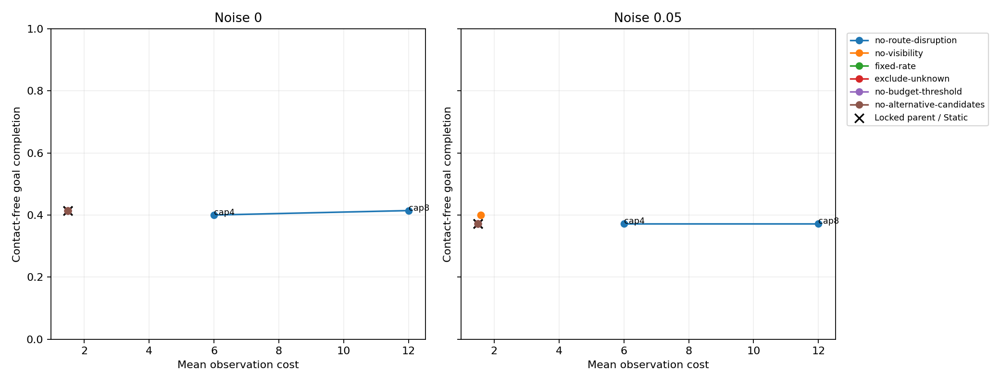
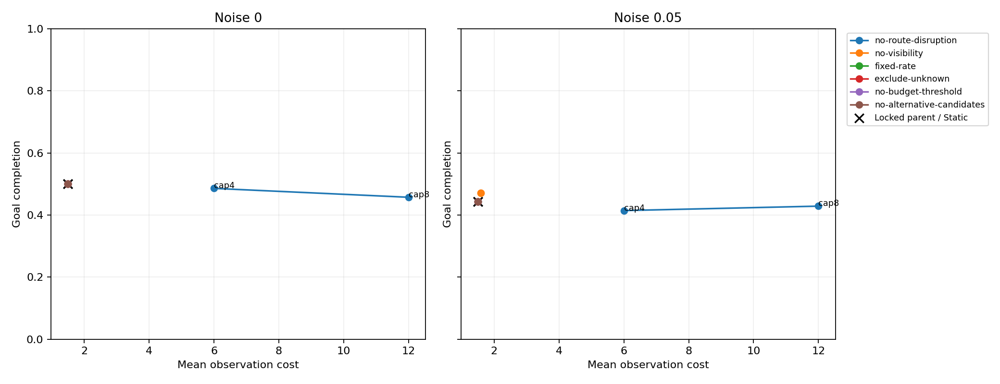

# Phase 1.4D frozen diagnostic ablations

Executed on 2026-11-06 on `feature/phase1-4c-assessment`, continuing the fetched
remote tip `9885f1bd0ea3408435304debf6ffce8d99dbde72`. No new branch, rewritten
commit, parameter selection or policy-equation change was made.

All **1,680 prescribed episodes** completed. Removing route disruption activated
sensing but reproduced the existing Periodic-1 control exactly in all 280 paired
scientific traces, at substantially higher observation cost than the locked
parent. Removing visibility activated only eight repeated settings from one
layout cluster. The other four ablations remained exactly Static. These are
diagnostic findings, not a newly validated method or a replacement confirmatory
test.

## Frozen inputs and scope

Read the [protocol](phase1_4_experimental_protocol.md),
[tuning validation](phase1_4b_validation.md),
[assessment validation](phase1_4c_validation.md) and
[pre-ablation review](phase1_4d_pre_diagnostic.md) before execution.
The initial preflight checked all original tracked files against the reviewed
base commit, all 13,440 parent trace sizes and SHA-256 values, the original
assessment manifest, selection artifacts, source dependencies and pinned package
versions. Resume sessions rechecked the frozen inputs and original tracked bytes,
reusing that completed parent-byte audit. Independent verification rechecked the
full parent inventory after execution.

The parameter-lock SHA-256 remains
`ecdd2f11e0c279bfa6c8557fcc646c4f714d2c7627deb731cbb366138a64d2f1`.
The assessment-manifest SHA-256 remains
`6335b77dd5838b2ea312d3293c939354e0b7f454eccbc679f0c59d4fe031c822`.
The original confirmatory result and its saved analysis files are unchanged:
disruption-visible minus route-weighted contact-free completion at cap4/noise0
is -1.43 percentage points, with the original interval [-10.05, 8.10] points.
No Phase 1.4C policy episode was rerun.

The matrix is 70 stored assessment environments x caps 4/8 x noise 0/.05 x six
ablations. Every method is disruption-visible with the same eight locked public
parameters, including `disruption_threshold=.4` and `budget_price=0`. Radius is
3, occlusion enabled, horizon 40, observation cost 1.5 and unknown handling
optimistic. Initial sensing is mandatory and charged. Existing world advancement,
memory updates, per-time sensor streams, A*, contacts and blocked movement are
unchanged. No assessment world was regenerated or selected by an outcome.

| Ablation | Existing frozen code branch |
| --- | --- |
| No route disruption | Set D_i=1 for each eligible candidate |
| No visibility | Set V_i=1 in score and visible-mass gate |
| Fixed rate | Use r_i=.05 in the public occupancy proxy |
| Exclude unknown | Remove unknown candidates; unknown ray blockers remain .5 |
| No budget threshold | Set lambda=0, already the selected value |
| No alternative candidates | Restrict candidates to the remembered nominal route |

All six existing branches were executed. No original source file was edited.
New adapters admit only the pinned assessment manifest and exact fixed jobs;
changed caps, noise, parameters, configuration, method, seed, partition or job
identity are rejected. Public smoke/tuning gates remain unchanged. No held-out
scenario was parsed, generated or evaluated. The original-file integrity audit
hashes reserved configuration bytes without using their contents experimentally;
the preflight's `held_out_accessed=false` flag refers to experimental admission,
not that byte-only integrity operation.

## Outcomes and observation activation

Each ablation has 280 executions. The following aggregate averages the four
predeclared cap/sensor settings within environment, then environments within
family and the seven families equally. These repeated executions are not 280
independent environments.

| Method | Contact-free /280 | Contact-free rate | Goal rate | Mean observations | Mean cost | Episodes with later sensing |
| --- | ---: | ---: | ---: | ---: | ---: | ---: |
| Locked parent / Static | 110 | 39.29% | 47.14% | 1.0000 | 1.5000 | 0/280 |
| No route disruption | 109 | 38.93% | 44.64% | 6.0000 | 9.0000 | 280/280 |
| No visibility | 114 | 40.71% | 48.57% | 1.0286 | 1.5429 | 8/280 |
| Fixed rate | 110 | 39.29% | 47.14% | 1.0000 | 1.5000 | 0/280 |
| Exclude unknown | 110 | 39.29% | 47.14% | 1.0000 | 1.5000 | 0/280 |
| No budget threshold | 110 | 39.29% | 47.14% | 1.0000 | 1.5000 | 0/280 |
| No alternative candidates | 110 | 39.29% | 47.14% | 1.0000 | 1.5000 | 0/280 |

| Method | Mean requests after initialization | Mean denials | Mean dynamic contacts | Mean blocked attempts | Mean elapsed steps | Mean path length |
| --- | ---: | ---: | ---: | ---: | ---: | ---: |
| Locked parent / each inactive control | 0 | 0 | .0786 | 18.5929 | 27.5786 | 8.9857 |
| No route disruption | 28.2286 | 23.2286 | .0750 | 16.9643 | 28.2286 | 10.6286 |
| No visibility | .0286 | 0 | .0786 | 18.0143 | 27.1786 | 9.1643 |

All requests and grants in these tables exclude initialization; observation count
and cost include it. Complete cumulative, terminal and common-horizon memory
errors, feasibility aggregates, runtime and computational counters are retained
in the episode and comparison tables, not conditioned on successful episodes.

### No route disruption: activation without improved aggregate navigation

Every decision requested sensing. Each episode observed at steps 0 through C-1,
then exhausted its cap and continued logging denied requests. All episodes
reached the full allowance: four calls/cost6 at cap4 and eight calls/cost12 at
cap8. Mean cost is six times the locked parent's cost. Aggregate contact-free
completion decreased by .36 percentage points and goal completion by 2.50 points.
This is not an improvement in observation-cost/performance tradeoff.
There are 23 paired contact-free gains and 24 losses, rather than uniformly
unchanged outcomes: the small aggregate conceals opposing environment effects.
The 1,400 extra grants and 6,504 denials come from 7,904 noninitial requests.

| Cap | Noise | Parent contact-free | No-disruption contact-free | Parent goal | No-disruption goal | No-disruption mean cost |
| --- | ---: | ---: | ---: | ---: | ---: | ---: |
| 4 | 0 | 41.43% | 40.00% | 50.00% | 48.57% | 6 |
| 4 | .05 | 37.14% | 37.14% | 44.29% | 41.43% | 6 |
| 8 | 0 | 41.43% | 41.43% | 50.00% | 45.71% | 12 |
| 8 | .05 | 37.14% | 37.14% | 44.29% | 42.86% | 12 |

A separate read-only [control verification](../results/phase1_4d/periodic1_equivalence.json)
compares all 280 no-disruption records to the existing Periodic-1 assessment
records. Observation times, positions, executed/planned paths, received
observations, memory, error frames and all checked scientific metrics agree
exactly. Scheduler diagnostics and runtime are excluded from that equality.
The [verification program](../results/phase1_4d/verify_periodic1_equivalence.py)
only reads saved records and checks hashes; it does not invoke an episode runner.

Removing D therefore demonstrates that this component suppresses sensing under
the selected parameters. It does not show that increased sensing improves the
task, that the remaining rule selects useful times, or that route awareness is
generally harmful. In this matrix, removing D reduces the request schedule to
the already evaluated always-request controller. The frozen implementation still
computes counterfactual routes before replacing D with 1; no computational
optimization was applied.

For context, the stored same-cap/sensor quota-periodic control has 56.79%
contact-free completion at mean cost5.861, and random-quota 55.43% at cost6.128
(random replicates averaged within environment). These are descriptive earlier
assessment controls, not new runs or exactly matched realized-cost comparisons.
They further caution against crediting a large number of early observations
with useful task-aware scheduling.

### No visibility: a small, clustered effect

Eight episodes made exactly one extra observation, always at step1; none made
a later request or incurred a denial. The cases are seed20000, noise .05, both
caps, in critical, reopen, occluded and budget. They represent **four environments
but one shared layout cluster**. Critical and reopen change from failure to
contact-free goal completion at both caps; occluded and budget remain failures.
Thus four improved repeated settings represent only two environments within
that same layout cluster, not four independent successes.
The other 272 full scientific traces match the locked parent and Static.

The aggregate contact-free and goal differences are each +1.43 percentage points,
with mean additional cost .0429. For each noisy cap separately the difference
is +2.86 points, and it is zero without noise. Removing visibility can expose
an observation opportunity in these saved cases; the small concentrated gain
does not establish that visibility estimation is generally harmful or that the
remaining task-aware score generalizes. Sensing quantity, timing and new noisy
measurements change together. No rate-matched causal comparison was added.

### Four inactive controls

All 1,120 fixed-rate, exclude-unknown, no-budget-threshold and no-alternative-
candidates episodes made zero noninitial requests and grants. Their full
motion/memory/observation/error signatures and scientific metric vectors match
both the locked parent and Static in every paired condition. This is exact
agreement on these realizations, not a general equivalence claim.

The negative outcomes have the predicted structural explanations: the selected
budget price already equals zero; removing nonnegative candidate terms cannot
initiate a request; and without a repeated observation, the adaptive rate stays
at its .3/6 prior, mathematically .05. Different candidate sets and probability
computations can still change scheduler cost without changing navigation.

### Trigger-component changes

The threshold remains .6 in every decision. Decision-weighted mean scores are
4.308837 for no-disruption, .061466 for no-visibility, .029560 for fixed-rate and
no-budget-threshold, .001112 for exclude-unknown and .029318 for route-only
candidates. No-disruption sets every candidate disruption to 1 and requests on
all 7,904 decisions. No-visibility sets every prediction to 1 but still fails
the score threshold on 7,602 of 7,610 decisions. The other controls fail that
threshold everywhere. Exclude-unknown additionally has 2,008 empty-candidate,
zero-visible-mass decisions. No other ablation fails the visible-mass gate.
Thus score attenuation is the central activation barrier; candidate removal can
add abstention conditions without rescuing sensing. Full condition-specific
component and failure counts are in `trigger_components.csv`.





The inactive controls overlap the parent/Static points in these figures; their
cap4 and cap8 points coincide. Lines connect only each ablation's two prescribed
caps, not selected points from different policies.

## Descriptive paired intervals and family sensitivity

All comparisons are ablation minus the original locked parent on exactly matched
environment/cap/noise cells. The global list has **37 layout clusters**: nine per
family except irrelevant, which has six; layouts shared across families remain
one resampling unit. The unchanged bootstrap uses seed1404001, 10,000 accepted
global layout draws, percentile .025/.975 bounds and equal-family weighting.
It accepted 10,000 of 10,011 attempts, rejecting 11 draws missing a family. All
caps, sensors and methods remain together when a layout is drawn. Aggregate
differences average the four settings within each environment before computing
the family-balanced statistic. There is no independent-sample interpretation
of the 1,680 repeated executions.

| Ablation | Contact-free difference, pp [95% interval] | Goal difference, pp [95% interval] | Mean observation difference | Mean cost difference |
| --- | ---: | ---: | ---: | ---: |
| No route disruption | -.36 [-6.24, 5.49] | -2.50 [-10.03, 4.25] | +5.0000 | +7.5000 |
| No visibility | +1.43 [0.00, 4.82] | +1.43 [0.00, 4.82] | +.0286 | +.0429 |
| Fixed rate | 0 [0, 0] | 0 [0, 0] | 0 | 0 |
| Exclude unknown | 0 [0, 0] | 0 [0, 0] | 0 | 0 |
| No budget threshold | 0 [0, 0] | 0 [0, 0] | 0 | 0 |
| No alternative candidates | 0 [0, 0] | 0 [0, 0] | 0 | 0 |

These are **exploratory/diagnostic, descriptive pointwise intervals**, not new
confirmatory tests or simultaneous superiority claims. Zero-width intervals in
the inactive scientific contrasts are degenerate because every observed pair
is identical; they do not establish universal equivalence. The two active
contact-free bootstrap distributions are nondegenerate. No-disruption's
leave-one-family-out contact-free estimates range from -6.67 to +5.00 points;
no-visibility's range is +.83 to +1.67 points. Family sensitivity and the single
activated layout cluster limit generalization. The original confirmatory test
and its interpretation remain intact.

## Memory errors and computation

All errors are all-episode means with the protocol's terminal memory frozen
through step40. These counters measure different failure modes; known-cell
staleness and missed changes do not penalize unknown cells identically.

| Method | Common-horizon stale errors | Missed persistent changes | False persistent occupancy updates |
| --- | ---: | ---: | ---: |
| Locked parent / each inactive control | 23.1071 | 35.6143 | 0 |
| No route disruption | 49.0357 | 26.6786 | 1.1857 |
| No visibility | 20.8214 | 35.6143 | 0 |

| Ablation | Mean scheduler ms/episode | Mean episode median decision ms | Mean episode P95 decision ms | Mean total A* calls/episode |
| --- | ---: | ---: | ---: | ---: |
| No route disruption | 117.441 | 3.391 | 6.198 | 1582.057 |
| No visibility | 90.187 | 2.796 | 4.969 | 1554.543 |
| Fixed rate | 93.962 | 2.847 | 4.952 | 1564.057 |
| Exclude unknown | 31.265 | .724 | 2.625 | 270.729 |
| No budget threshold | 96.199 | 2.924 | 5.141 | 1564.057 |
| No alternative candidates | 28.238 | .901 | 1.580 | 229.543 |

The latency columns average the saved per-environment/cap/sensor episode
percentiles, rather than pooling all decisions into one percentile. Total A*
includes both scheduler and common movement-planner calls. Separate scheduler,
diagnostic and common-planner durations and call counts remain in the tables.
Runtime comparisons use different execution sessions and remain descriptive;
counter reductions do not imply improved navigation in the inactive controls.

## Execution, checkpointing and reproducibility

The runner uses existing instrumented evaluation interfaces and the unchanged
POSIX `fcntl` lease, atomic-write and directory-fsync primitives. Each job ID
hashes environment/layout/family/seed, ablation, cap, noise, replicate, all locked
parameters and the full episode configuration. The run identity additionally
freezes the job-plan hash, source hashes, Python/platform and dependencies.

Complete original frames, decision components, observation arrays, memories,
evaluator truth and feasibility samples are stored in per-episode gzip JSON.
Each published trace has an immutable SHA-256/size receipt checked on resume.
Torn staged files are preserved in quarantine; complete staged or unreceipted
published checkpoints can be adopted without episode reexecution. Conflicts,
changed byte receipts, unknown IDs and missing/extra records stop validation.
These recovery paths were tested synthetically; the actual run required none.

| Session | Already complete | Newly executed | Complete afterwards | Recovery actions |
| --- | ---: | ---: | ---: | ---: |
| Initial integration | 0 | 2 | 2 | 0 |
| Zero-new resume | 2 | 0 | 2 | 0 |
| Remaining matrix | 2 | 1,678 | 1,680 | 0 |

Run ID: `e62ededc68e5e7e66098a1c7323eb3c7e8a6268810df67f398e1e9d5cab1780c`.
Generating Git HEAD is the reviewed parent with dirty=true because new adapters
were implemented before their final commit; explicit generating source hashes
are retained. This is not a claim that the run knew its eventual publication SHA.

Execution used Ubuntu WSL2, Python3.12.3, NumPy2.2.6, Matplotlib3.10.3 and
pytest8.3.5, with full transitive package/platform metadata in run provenance.
One untimed synthetic public-memory decision per ablation preceded each executing
session. Evaluation was single-process with no rendering or tests running during
the matrix. The initial and final loops took .3491 and 266.9648 seconds, totaling
**267.314 seconds** including checkpoint/receipt writes, excluding preflight,
warm-up, inventory export and analysis.

The compressed traces total **18,719,485 bytes**. They remain outside Git at
`results/raw/phase1_4d_ablations/`, alongside receipts and run/session contracts.
The full [trace inventory](../results/phase1_4d/trace_storage_manifest.json)
records every exact path, size and SHA-256. A Git clone alone cannot validate raw
traces: preserve this directory and the original Phase1.4C raw archive separately.
Uncompressed complete JSON totals **388,407,295 bytes**. The Windows path is
`C:/Users/81704/Desktop/fujita/31_humanoid-spatial-memory/humanoid-spatial-memory/results/raw/phase1_4d_ablations/`;
the corresponding absolute WSL path is recorded in the inventory.
Independent byte verification, reconstruction, bootstrap and plotting took
**533.465 seconds**, including rechecking the original 13,440 parent traces.

Reproduction commands, from the repository in Ubuntu WSL:

```bash
.venv-wsl/bin/python scripts/run_frozen_ablations.py --preflight-only
.venv-wsl/bin/python -m pytest -q -o cache_dir=/var/tmp/hsm-pytest-cache
.venv-wsl/bin/python scripts/run_frozen_ablations.py --max-new-episodes 2
.venv-wsl/bin/python scripts/run_frozen_ablations.py --max-new-episodes 0
.venv-wsl/bin/python scripts/run_frozen_ablations.py
.venv-wsl/bin/python scripts/analyze_frozen_ablations.py
.venv-wsl/bin/python results/phase1_4d/verify_periodic1_equivalence.py
```

The retained raw run resumes by verifying and skipping completed episodes.
Scientific replay can reproduce decisions/outcomes; fresh timing-containing
gzip bytes need not reproduce the original hashes. Native Windows storage is
not substituted for the required POSIX lease and fsync behavior.
Exact resume also checks dependency identity and the original working-tree byte
inventory, including line-ending representations. Preserve the generating
checkout and environment alongside the raw archive; a differently normalized
clone is not an interchangeable checkpoint environment.

## Validation and remaining limits

The full suite passes **204 tests**, with 14 existing Matplotlib/pyparsing
deprecation warnings. The new tests cover all six frozen branches on synthetic
fixtures, independently constructed job identities, reserved-input rejection,
changed jobs, trace/trigger tampering, leases, duplicate publication, checksum
receipts, torn-file preservation, checkpoint adoption and zero-reexecution resume.
Historical regression checks retain all **2,212** original records, and the
original-file byte inventory is unchanged. No existing result or configuration
was rewritten by the runner, tests or analysis.

The [independent verification report](../results/phase1_4d/independent_verification.json)
confirms all 1,680 raw checksums and receipts, no missing or duplicate records,
**36,960** independently reconstructed metric values, **46,402** reconstructed
decisions and all 37 generating source files. The verifier independently builds
the exact matrix and reconstructs public-history probabilities, visibility,
candidate eligibility, score sums, gates, actual movement, contact/error ledgers,
observation feasibility labels and computational counters. It reads saved
counterfactual costs to verify normalized disruption; it does not reexecute
counterfactual searches or any policy episode. Wall-clock durations are checked
against frame sums and percentiles, not independently reproduced.

Retained compact artifacts under `results/phase1_4d/` include:

- `episodes.jsonl` and `episodes.csv`: all 1,680 jobs and metrics.
- `summary.csv`, `per_family.csv` and `paired_episode_differences.csv`: complete
  setting/family summaries and every paired episode difference.
- `paired_comparisons.json` and `.csv`: all outcome contrasts, pointwise
  intervals, degeneracy and leave-one-family-out sensitivity.
- `observation_activation.json`, `activation_summary.json` and
  `trigger_components.csv`: grants/timing, requests/denials and trigger changes.
- `feasibility_calibration.csv`: fixed-bin sensed-only calibration by known or
  unknown blockers; all original feasibility samples remain in raw traces.
- `assessment_context_controls.csv` and `periodic1_equivalence.json`: existing
  controls and the independently checked Periodic-1 identity.
- `preflight.json`, `run_provenance.json`, `test_results.txt`,
  `layout_cluster_audit.json`, `trace_storage_manifest.json`,
  `independent_verification.json`, figures and artifact checksums.

Activation, outcome improvement and support for task-aware sensing are distinct.
The two active ablations demonstrate activation differences. No-disruption fails
to improve aggregate navigation despite many more calls; no-visibility has a
small gain confined to one layout cluster. Neither result validates a new method
or permits selection of different Phase1.4 parameters. The four exact negative
controls are retained rather than dropped.

Sensor feasibility is measured only on actually granted calls and has selection
bias; dependent rays are not independent samples. Fixed scenario families,
related layouts, last-write maps, known pose, instantaneous sensing and point-grid
movement remain limiting assumptions. Runtime measurements on the WSL shared
filesystem and across separate sessions are descriptive, not physical deadlines
or evidence of humanoid safety. Missing tuning raw traces remain a limitation of
the preceding tuning-component review; no replacement tuning run was performed.

No Phase1.5 implementation, parameter revision, held-out evaluation or MuJoCo
integration was started. Stop for research review.
