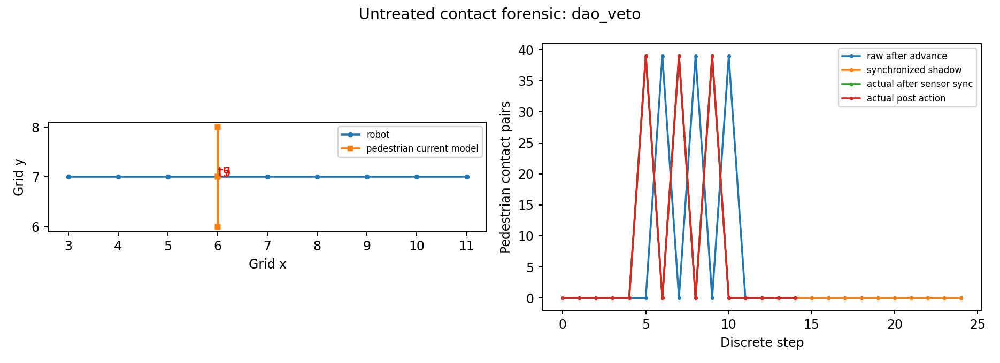
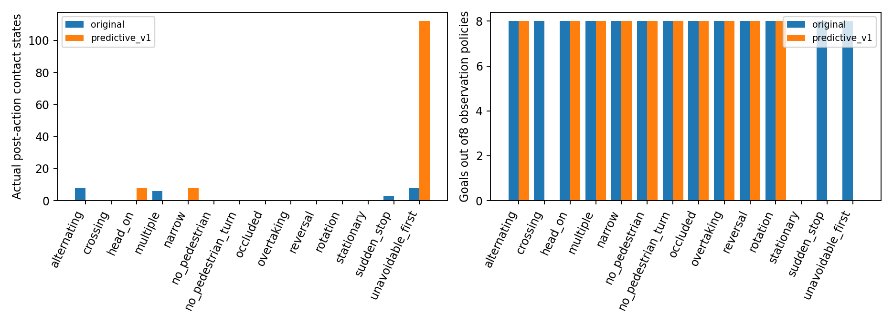
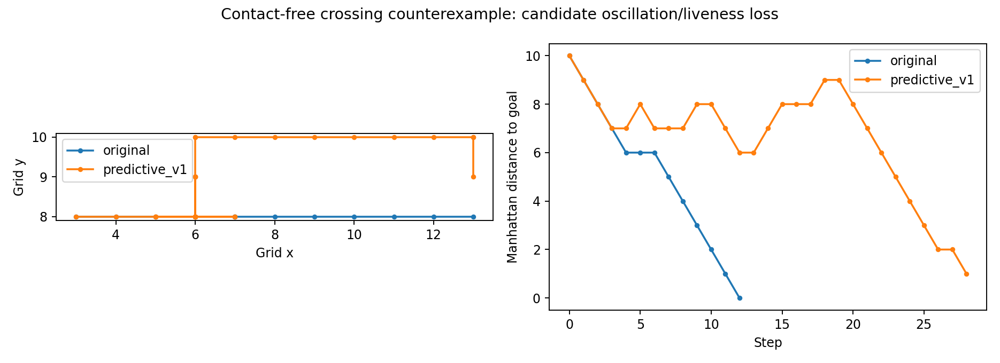

# Predictive emergency safety v1: contact forensics and engineering results

**Reject the candidate as a common safety replacement.** It removes the archived
regression contacts but loses navigation completion; the prospective benchmark
introduces new contacts in previously contact-free head-on/narrow cases and
repeated uncertified waiting in the first-transition-contact fixture. No safety,
independent-efficacy or production-pilot readiness claim is supported.

Base `1671e26f9b1360a4f061c5a04934a1374c789f83`; prospective source/scene/criteria
freeze `6aab1e1`. University-library Mac, existing Python3.12 `.venv`, branch
`phase2/mujoco-proxy-pilot`. All DAO/CAA/Age/EVI equations, original safety,
planner, G1 geometry, environment timing, pedestrian paths and sensor settings
remain unchanged. The candidate is a separate common infrastructure version.
No production cohort, reserved access, new full FIT72 screen or DAO winner.

## Actual execution and checks

216 focused tests passed,0 failed, including13 new predictive-safety test cases,
previous integration/generator/statistics/regression suites and existing safety
outcome tests. Independent reachability checks enumerate stay/cardinal paths;
translation is checked against300 independent dense trajectories and rotation
against1001 angles. Waiting risk, reversal, multiple/missing tracks, no escape,
negative controls and no hidden-geometry/sensor dependencies are tested.

Seven untreated forensic episodes preceded candidate implementation: four DAO
archive replays plus Periodic4/Age4/Age5 on the same pedestrian scene. All four
DAO semantic traces and non-timing metric signatures match exactly. Two separate
3-step adapter plumbing episodes completed before freeze; they did not choose
parameters. The formal matrix completed **416 episodes once**:26 hand-defined
scenes×8 observation schedulers×2 safety versions. All48 original-safety DAO
regression episodes match archived semantic/metric signatures. Thus425 published
engineering episodes comprise7 audit+2 plumbing+416 formal; internal legacy
pytest navigation probes are separate test execution, not efficacy samples.
No failed audit/formal execution or recovery rerun occurred in this task.

## What actually caused the archived contacts

[Pre-candidate contact audit](predictive_safety_contact_audit.md) documents the
mechanism BEFORE implementation. The four DAO results reproduce117/39/39/39
pedestrian pair sums at steps Veto5/7/9, Trigger11, Route5, Combined11.
Periodic4 and Age4 each have78 pairs at5/7; Age5 has39 at5. Pair sums are
geometry-pair/state aggregates, not independent collision counts.

The actual order is:

1. Previous executed model state is contact-free before the offending advance.
2. `World.advance()` changes the discrete pedestrian program index but leaves
   actual MuJoCo mocaps at the prior position. Raw post-advance model state
   still shows no new contact.
3. A separate evaluator-only MjData copy synchronized to the CURRENT world
   index shows an overlap at the unchanged robot pose. This copy never alters
   the actual model or supplies an online measurement.
4. The original emergency sensor's `observe` synchronizes mocaps and calls
   `mj_forward`. All39 pedestrian/G1 geometry contacts appear at that actual
   synchronization BEFORE safety selection or the robot action.
5. The post-action frame retains the contact. Rejected hypothetical shield
   samples are separately tagged and never added to executed-state episodes.

At step4 Veto/Route see a proxy at(6,6) moving(0,-1). The original direction-
restricted reachable set {(6,6),(6,5)} excludes a reversal to(6,7), so it allows
robot(5,7)→(6,7). At5 the program returns there and overlap already exists at
sensor synchronization. Trigger/Combined repeat the sign-reversed mechanism
at10→11. Veto's later7/9 onsets are separated by contact-free steps, not repeated
counting of one continuing state. The sensor DID detect the pedestrian; the
initiating error here is directional overconfidence plus advance-before-response
and mocap teleport timing, not an unseen future schedule in the policy.

A previous-position wait has an analytic XY-separation witness for those first
archived onsets, but no forced-action causal intervention was run. Once the
onset exists at the next scan, that step's action cannot erase its history.
Waiting or having no observed-clear escape is not a safety certificate. The
model contains no continuous pedestrian trajectory between teleported cells;
we do not infer continuous dynamics or real-world velocity guarantees.

Every formal contact has a timeline, stage evidence, public decision/certificate,
causal hypothesis and trajectory/stage figure under `contact_cases/`:
**165 distinct actual contact episodes across57 contacted formal runs**. All
165 onsets occur at actual emergency-sensor synchronization and are reproduced
by the evaluator synchronized-reference stage. No onset is attributed to an
accepted translation/rotation. Hypothetical selected-action collisions rejected
by the unchanged shield remain distinct from actual states. Seven additional
untreated forensic plots show the full original geometry/stage traces.



## Justified candidate and exact assumptions

`predictive_emergency_v1.py` retains only public dimensions/footprint and actual
independent emergency measurements/timestamps. It never queries actual geometry,
A*, sensors, future paths or shields. It is applied identically to Periodic4,
Age4, Age5, CAA-Full and all four DAO variants. The original memory scheduler,
ternary last-write updates, paid cap20 and navigation planner are unchanged.

For an emergency hit-cell set C observed at s, possible current proxy cells are
C dilated by Manhattan radius t-s (one cardinal cell/transition, including stop/
reversal/lateral movement). Retain uncertain/multiple/missed tracks for2 steps;
unique within-bound single-cell reacquisition replaces its prior sample.
P0 unions current possibilities; P2=P0 dilated by2. No hidden wall pruning or
velocity-direction exclusion. Track expiry/no detections explicitly limits
scope; it does not certify an absence of unseen pedestrians.

The declared proxy is a0.19m-radius, grid-centered capsule at scale0.75m. This
lets a first-hit surface raster cell identify its integer center cell only in
this particular model. It is not calibrated human localization. Certification
is conditional on these assumptions and observed tracks, not occlusion/global
or continuous-time safety.

Check the entire current translation sweep against P0 with analytic segment/
expanded-AABB slabs. For rotation use a circumradius bound covering every yaw,
then the target oriented endpoint footprint. Check the endpoint against P2,
and require measured emergency-grid static clearance along the sweep. The
public current pose is not written into memory as a free inference. Wait is
checked identically. Only the FINAL selected executable action uses the actual
shield; no true-geometry alternative probe is made.

Preserve a certified selected action. Otherwise consider at most selected,
forward, left/right sidestep, retreat, left/right turn and wait. Choose a
certified alternative by public goal Manhattan distance, deterministic ties.
If none certifiable, explicitly mark it and use UNCERTIFIED fallback wait.
With no observed tracks preserve the original action and report limited scope.
Constants/catalogue were frozen before the416 outcomes; none was tuned afterward.
See [prospective protocol](predictive_safety_v1_protocol.md) for exact rules.

## Regression and prospective results stay separate

| Set / safety | Episodes | Goals | Contact-free goals | Contact pairs | Contact states / distinct episodes | Paid scans | Emergency scans | Combined rays |
|---|---:|---:|---:|---:|---:|---:|---:|---:|
| Original12 / original |96|80|72|468|12 /12|331|1128|88999|
| Original12 / predictive |96|72|72|0|0 /0|389|1208|97417|
| New14 / original |112|104|79|975|25 /25|577|1529|128466|
| New14 / predictive |112|80|64|4992|128 /128|757|2054|171471|

Regression:0 rescues,8 goal harms,72 paired common successes with exactly0 step/
distance change. Contacts are removed, but the contact-free goal total stays72
and the archived pedestrian scene loses all8 scheduler goals. Candidate retreat/
sidestep oscillation is not useful liveness merely because it continues moving.

Prospective:0 rescues,24 goal harms. Among80 common successes, mean candidate
cost increases2.325 steps and1.89375m. Short failed paths are not counted as
navigation efficiency. Paid and total sensing BOTH increase; no joint benefit.
These are correlated hand scenes and schedulers, not independent population
samples or a basis for statistical superiority.

| New benchmark mechanism | Goals original→candidate (out of8) | Contact states original→candidate |
|---|---:|---:|
| Crossing |8→0|0→0|
| Head-on |8→8|0→8|
| Overtaking |8→8|0→0|
| Sudden stop |8→0|3→0|
| Reversal |8→8|0→0|
| Alternating crossing |8→8|8→0|
| Occluded approach |8→8|0→0|
| Multiple pedestrians |8→8|6→0|
| Narrow corridor |8→8|0→8|
| Rotation near proxy |8→8|0→0|
| Stationary proxy |0→0|0→0|
| No pedestrian |8→8|0→0|
| Unavoidable first transition |8→0|8→112|
| No-pedestrian turn |8→8|0→0|

All16 paired no-pedestrian negative controls have EXACT unchanged semantic
traces and zero contacts. That condition passes, but head-on and narrow create
**16 new contacted scheduler/case pairs** that were originally contact-free;
the broader no-new-contact acceptance condition fails.



## Why the candidate fails; unavoidable does not excuse later contacts

In head-on/narrow at step5, the original planner already selects a sidestep
(7,8)→(7,7) with actual scan clearance. The candidate rejects its endpoint
because a2-transition worst-case proxy could reach it, finds no catalogue action
certifiable, and waits UNCERTIFIED. At6 the real straight-moving proxy enters
(7,8); contact already exists at the next sensor sync. Original safety executes
the sidestep and has no contact. Conservative risk is not actual collision;
treating no certificate as a fallback wait does not guarantee safety. A bounded
catalogue/two-transition endpoint constraint is insufficient for viability.

The unavoidable-first fixture puts the pedestrian in the robot's start cell
at transition1 before ANY possible robot action. Those8 first onsets per safety version (16 overall, one per
scheduler and version) are a timing lower bound. **The candidate's
104 additional later contacts in that fixture are NOT proven unavoidable**:
its repeated no-certificate waiting prevents the original version's later
escape, producing14 onsets per run instead of1. The original still reaches8/8;
the candidate reaches0/8. Head-on/narrow add16 other non-first onsets. No claim
of physical unavoidability is inferred from the candidate's uncertainty set.

The crossing and sudden-stop fixtures also lose goals without contact; local
Manhattan-ranked escapes can oscillate instead of making route progress. No
planner was modified to conceal that limitation. Stationary-proxy failure in
both versions remains a negative control on liveness claims. See the saved
crossing path/distance-to-goal counterexample, plus all onset-specific evidence.



## Action, intervention, sensing and computation accounting

| Set / safety | Blocks / rejected selected actions | Explicit waits | Sidesteps | Retreats | No certificate | Interventions |
|---|---:|---:|---:|---:|---:|---:|
| Regression / original |4 /4|16|26|0|not implemented|18|
| Regression / predictive |0 /0|0|24|40|0|110|
| Benchmark / original |14 /14|285|50|0|not implemented|303|
| Benchmark / predictive |0 /0|280|250|24|272|729|

No-certificate frequency is272/2054 candidate benchmark decisions(13.24%).
Idle counts also include absent planner actions: regression402→384, benchmark
285→280. These totals do not demonstrate liveness: moving oscillations lose goals.
Original no-certificate is not a defined certification system, not proof that
its choices were certified safe.

Predeclared unnecessary-intervention PROXY compares the original selected
current public-AABB sweep and its endpoint against evaluator current/actual
next2 proxy positions, offline only. Regression proxy rates are0/18 original,
110/110 candidate; benchmark224/303(73.93%) original,421/729(57.75%) candidate.
These are hindsight-clear geometric counterfactuals at each policy's own
visited states, not proof that interventions are causally unnecessary or
unsafe to omit under uncertainty. Candidate overrides without a current visible
hit occur120 times with retained uncertain tracks. Actual emergency observations
are unchanged: no extra ray is hidden in safety or diagnostic channels.

Actual paid/emergency rays are recorded separately (61 each scan): regression
20191/68808→23729/73688; benchmark35197/93269→46177/125294. Sensor calls equal
paid authorizations/emergency steps; all caps/last-write memory/selected-only
shield counts pass. Actual selected shield calls are regression726→824 and
benchmark1244→1774. Rejected hypothetical contact samples4/14 original are NOT
executed-contact incidents. Evaluator geometry-distance/shadow probes use zero
actual rays and are never online inputs; their CPU remains in episode wall time.

Mean safety-boundary time per decision is regression original0.00178ms versus
candidate0.02195ms, benchmark0.00530ms versus0.05004ms. Total instrumented wall
seconds are regression7.847→8.368 and benchmark9.461→12.776; full416-process
matrix42.159s. These include evaluator instrumentation/I/O/model construction
and changed trajectory lengths, not pure robot runtime or cross-Mac speedups.
Peak RSS was not separately recorded. Candidate computation and sensing cost
increase, not an efficiency improvement.

Minimum evaluator-measured signed pedestrian/G1 geometry separation is
-0.26191m in original regression and both benchmark versions; predictive
regression minimum is+1.05173m. Negative values are model penetration, not
physical-human distance estimates. Continuous motion between teleported proxy
poses is absent; no real-world humanoid safety is established.

## Preservation, pilot readiness and stop decision

Original2907 checkpoint/receipt pairs,836 protected files, all previous CAA/DAO/
integration artifacts and58 G1 assets are rehashed. Original algorithms and
failed artifacts remain immutable. Source/scene/test/criteria hashes were
committed before formal outcomes; all48 untreated DAO regression parities pass.
The416-case matrix is complete;7 forensic+2 plumbing ledgers remain separate.
Every contact timeline/figure and negative outcome is preserved under
`results/phase2_mujoco/predictive_safety_v1/` with manifests.

[Updated readiness assessment](predictive_safety_pilot_readiness.md): candidate
rejected; production pilot stays unready. Remaining independent blockers are
unchanged: generator width bias and missing occlusion treatment coverage,
production duplicate matching scalability, unavailable authorized prior opaque
signatures, no independently enforced custody/sealed access, approximate
statistical interval undercoverage, and unapproved margins/power-justified size.
No blocker is silently approved or declared solved by this safety study.

Do not promote the candidate, retune its horizon/catalogue, modify DAO, change
pedestrian speed/timing, omit contacts or generate populations. A future safety
hypothesis or a physically different timing model requires a separate prospective
protocol. This task ends with a reproducible rejection and mechanism evidence.

## Reproduction

```sh
.venv/bin/python scripts/safety_forensics_v1.py
.venv/bin/python scripts/run_predictive_safety_v1.py prepare
# Commit prospective source/scenarios/binding before outcomes.
.venv/bin/python scripts/run_predictive_safety_v1.py formal
MPLCONFIGDIR=/private/tmp/dao-matplotlib .venv/bin/python scripts/report_predictive_safety_v1.py
MPLCONFIGDIR=/private/tmp/dao-matplotlib .venv/bin/python scripts/export_safety_contact_cases_v1.py
```

Existing outputs refuse overwrite. A future replication needs a new versioned
output root and prospective source binding; do not delete current evidence.
JUnit/commands, stage geometry, paid observations, original/candidate decisions,
case/arm/role-separated results and all165 contact timelines are saved. No
follow-on policy iteration or production experiment was started.
