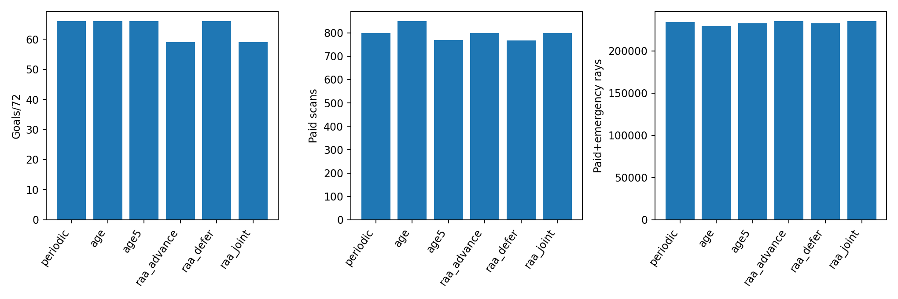

# Route-Adaptive Age v1 — executed FIT72 research report

**RAA-Defer meets the owner's original descriptive target and the immediate
Age5 target:66/72 goals,0 contacts,768 paid scans versus Age5's770.** The saving
is only two terminal-step scans from one maze/two correlated schedules. There
are no new goals or movement improvements. RAA-Advance and Joint fail badly
at59/72 and are rejected. A strong joint or independently novel/generalizable
algorithmic improvement is NOT established.

Base9333928aa52acb24d42b739549bcaaa8a2180dbc; prospective source/protocol freeze
`d91eee267cd5513027e7dd1679508646608b23a9`; branch
`phase2/mujoco-proxy-pilot`; university-library Mac; existing Python3.12 `.venv`.
The work includes implementation and actual navigation, not just retrospective
analysis or another hand-designed safety benchmark. Original safety is unchanged.

## What was executed

137 focused correctness/regression tests passed,0 failed (including11 new RAA
cases), then the original two-case six-arm smoke:12 episodes. The full frozen
matrix completed72×6=432 episodes once, for444 published actual G1 episodes.
All216 full and6 smoke Periodic4/Age4/Age5 reference metric signatures and semantic
traces match; first-two full cases also match smoke. Actual paid sensor calls
match grants exactly, cap20 inclusive and selected-only shield invariants pass.
All arms have zero unwanted contacts. No failed run or parameter/harness repair
was needed after prospective freeze. No new safety version was activated.

The immediate target is >=67 goals OR66 with<=769 paid scans, zero contacts.
The first family contains an immediate-target success, so the protocol's
FAILURE-ONLY additional revision condition is not triggered. No second family,
threshold sweep or follow-on iteration was run. Negative Advance/Joint results
remain complete and visible; they were not replaced with a tuned variant.

## Prior evidence guided the parent change

Latest Deadline/Stable/Quiet lost14/15/15 Age5 successes. In10 harms per arm the
first scan difference was5, the first ordinary Age5 reading. Saved Deadline
harm cases had149 blocks including24 repeated identical pose/heading/action
rejections; Stable/Quiet140/142 blocks and23 repeated rejections each. Scan and
first action differences can be separated by many steps. Per-cell maps and
omitted scan contents were not present in those saved traces; no unavailable
reading was inferred. All70 exact-key retries have an intervening authorized scan. The original
evaluator clears rejected action keys when a scan changes the local memory
signature, explaining retry eligibility. Saved traces do not establish the
unsaved geometric cause or the goal counterfactual. See additional_checks/.
These are associations, not causal proofs.

Retrospective omission masks selected on hand-defined observations did not
compose into successful rollout policies. RAA switches to Age5, protects its
FIRST noninitial observation and preserves ordinary requests except a one-step
promise that must be honored next if the episode continues. It does not inherit
the weak DAO parent,10-step deadline or repeated quiet-history veto.

Previous Route-Clock could trigger at a2-step half interval, used occupied
route neighbors and a View-Veto/Age4 parent; it reached66 goals with932 scans.
Event+Age added scans without improving goals. Age-Motion used displacement/
heading; CAA used per-cell history classes and achieved the same768 scan total
here with a different small signal. RAA is a distinct bounded Age5 timing
hypothesis, not proof that route-conditioned Age itself is new or a superior
new research contribution. All previous algorithms/results remain frozen.

## Implemented mathematics and computational boundary

The [frozen protocol](raa_v1_protocol.md) defines all constants/conditions.
`route_adaptive_age_v1.py` accepts only authorized ternary memory/timestamps,
known endpoint-change history, public pose/heading/goal/unknown rule and public
planning. It has no world, emergency data, omitted readings, outcome labels,
future trajectory or actual collision-check access. Memory changes only after
an actual current grant; unknown outputs do not change cells/timestamps.

Let A4/A5/A6 be original radius3 known-cell stale fractions at age4/5/6, threshold
0.5. The first noninitial scan is ordinary Age5. At most one extra point-grid
A* and one current optimistic61-ray memory footprint are computed per eligible
decision. The next4/5 point-route moves are expanded by public G1 translation
AABBs and intervening turn circumradius bounds, never actual shield queries.
An occupied current cell makes a nominal route unavailable without clearing it.

- **Advance** preserves A5 and additionally requests A4 AND NOT A5, after the
  first parent scan, gap>=4, usable route, and a predicted-visible unknown or
  actual recent-known-change cell in next4 swept moves.
- **Defer** preserves A5 except a one-step postponement after the first scan
  when gap<6, a usable next5 swept prefix is all free/fresher than5, the predicted
  current view is nonempty/all known/fresher than5, and no known change was
  observed there within5. Missing routes/unknown near-term traversal/meaningful
  changes cannot defer. At next integer decision, FORCE the request independent
  of route, pose or new A5 score; no repeated deferral of that request.
- **Joint** combines those exact two mechanisms. **Off** is a test-only disabled
  control matching historical CadenceController Age5 API decisions, scores,
  maps, timestamps and cap behavior on240 randomized decision states.

Tests explicitly force a continuing-episode deferral even when the next public
route/A5 score becomes unavailable, and verify authorization/cap exhaustion,
first-scan protection, deterministic replay, unknown readings and bounds.
This enforcement is exercised in tests, NOT observed in a continuing FIT episode:
the only two actual deferrals end in goal completion before a next decision.

Map limit4096 cells; maximum extra one public A*, one61×81 arithmetic footprint
and<=200 swept-cell visits per eligible decision. Work O(N log N+4941) including
planning/validation; memory O(N) plus O(T) retained diagnostic output. The original
G1 planner, H80/seed42, actual61-ray sensor, independent emergency safety and
20-observation budget are unchanged. Predicted footprint is not a physical
visibility bound or an actual observation.

## Complete six-arm results

| Policy | Goals / contact-free goals | Paid scans | H80 steps | Distance m (all episodes) | Blocks | Emergency scans | Combined rays | Contacts |
|---|---:|---:|---:|---:|---:|---:|---:|---:|
| Periodic4 |66 /66|800|3039|1659.0|47|3039|234179|0|
| Age4 |66 /66|850|2915|1612.5|36|2915|229665|0|
| Age5 |66 /66|770|3044|1666.5|63|3044|232654|0|
| RAA-Advance |59 /59|800|3058|1684.5|42|3058|235338|0|
| RAA-Defer |66 /66|768|3044|1666.5|63|3044|232532|0|
| RAA-Joint |59 /59|800|3058|1684.5|42|3058|235338|0|

Defer saves32 paid scans(4%) versus Periodic4,82(9.65%) versus Age4 and2(0.26%)
versus Age5. It preserves the exact Age5 goal/failure set and ALL72 navigation
traces (actions/reasons/pose/heading/motion/blocks/contact fields), not the final
memory observation contents. No new success occurs; the >=67-goal target fails,
but the66-with<=769 alternative succeeds. This is a literal descriptive win,
not a large or independent improvement.

| Candidate vs reference | Rescues / harms | Common successes | Common step delta | Common distance delta m |
|---|---:|---:|---:|---:|
| Advance vs Periodic4 |0 /7|59|-2.186441|-0.838983|
| Advance vs Age4 |0 /7|59|-0.305085|-0.101695|
| Advance vs Age5 |0 /7|59|-1.491525|-0.508475|
| Defer vs Periodic4 |2 /2|64|+0.390625|+0.304688|
| Defer vs Age4 |3 /3|63|+2.253968|+1.000000|
| Defer vs Age5 |0 /0|66|0|0|
| Joint vs Periodic4 |0 /7|59|-2.186441|-0.838983|
| Joint vs Age4 |0 /7|59|-0.305085|-0.101695|
| Joint vs Age5 |0 /7|59|-1.491525|-0.508475|

Only paired common successes enter movement comparisons; failed short paths
are never counted as efficiency gains. Advance/Joint improve some common-
success movement costs but lose7 completions and increase paid/combined sensing.
Defer has unchanged Age5 movement, worse common-success movement than Periodic/
Age4 and2867 MORE combined rays than Age4. Thus no arm achieves the stronger
joint sensing/navigation target across all three references.



## Exactly where the Defer signal occurs

Both savings are M:80030002 schedules0/1, at decision50. Age5 has just scanned
at49; local A4/A5/A6 fractions are all0.5 due to other old local known cells.
The public route prefix is(9,20)→goal(10,20), and both swept cells are known free/
fresh. Predicted view has7 known fresh cells,0 unknown/0 stale. The one-step
request is delayed; the unchanged action reaches the goal at50, so there is
no next decision and no overdue promise. Parent13 paid scans become12 each.
There is no episode-identity or special terminal-step feature in the code.

**The skipped parent scans actually discover one new cell each** (10 observed,
9 repeated unchanged,0 changed-known), despite predicted zero unknowns. This
prediction error is retained. Do not call these scans information-free/useless
or the footprint calibrated. The goal is reached before the delayed observation
would be needed, but this does not establish harmless deferral on longer tasks.
No omitted reading enters the online scheduler; parent content is joined offline
only after the frozen matrix completes.

Only2/1064 Defer feature computations authorize postponement. There are74
fresh-view and17 free/fresh-prefix certificates, whose intersection with all
other guards leaves the two terminal decisions. No continuing-episode forced
scan activates in FIT72; only unit tests exercise that promise. Advance grants336
early scans; Joint also grants336 and its full semantic traces equal Advance
in all72 cases. Combining mechanisms changes which states are visited, so
ablation activation does not add linearly.

Whole-maze bootstrap (2000 draws, seed2026111602,36 maze clusters with schedules
kept together) gives Defer-minus-Age5 paid difference95% interval
[-0.083333,0] scans/episode. It includes zero and depends on one reused lineage.
These are exploratory unadjusted development intervals, not an independently
validated inference procedure. Novelty, generalization and deployment superiority
remain unestablished. Matching CAA's historical768 total is not a claim of a
new best method across every earlier candidate.

## Advance/Joint failure analysis, not hidden by the successful ablation

All7 newly harmed Age5 successes first change scan timing at9, after the
protected parent scan5. Early scans reveal2–28 new cells and0 changed-known
cells in these harmed cases. First action changes are9/11/13/22; hence a scan
shift need not immediately change the action and does not alone prove causality.

| FIT key / schedule | First scan / action difference | Parent→Advance scans | First budget-exhausted decision | Blocks parent→Advance |
|---|---|---:|---:|---:|
| M:80030008 /0 |9 /13|12→20|61|1→2|
| M:80030009 /0 |9 /9|20→20|62|1→2|
| M:80030009 /1 |9 /9|20→20|62|1→2|
| R:80000000 /0 |9 /22|15→20|none before end|1→1|
| R:80000000 /1 |9 /22|15→20|none before end|1→1|
| R:80000017 /0 |9 /11|20→20|71|2→2|
| R:80000017 /1 |9 /11|19→20|71|2→2|

Five cases exhaust budget before the end, but the other two still scan at80;
budget exhaustion is NOT a complete explanation. These failures continue
moving54–62 times and turning18–26 times, with no repeated identical-pose/action
rejection. Unlike the prior Deadline collapse, they are not simply repeated
blocked-action stalls. Public point-route unknownness/known changes and an
Age4 gate do not establish that observing earlier improves G1 route choice or
dynamic timing. More information/scans can alter paths and spend the budget
without improving completion. We did not run an isolated forced-scan causal
intervention or infer unavailable counterfactual readings.

## Sensing, errors and measured cost

| Policy | Paid rays | Emergency rays | Emergency interventions | False-persistent / missed-change cell-times | Mean scheduler ms/episode | Mean episode seconds |
|---|---:|---:|---:|---:|---:|---:|
| Periodic4 |48800|185379|7|64 /5850|0.052435|0.158257|
| Age4 |51850|177815|5|62 /5611|0.964922|0.152328|
| Age5 |46970|185684|21|70 /5588|2.386736|0.156992|
| RAA-Advance |48800|186538|15|65 /5719|20.638420|0.184326|
| RAA-Defer |46848|185684|21|70 /5588|28.590126|0.182348|
| RAA-Joint |48800|186538|15|65 /5719|20.637360|0.183805|

Defer reduces combined rays by122(0.052%) versus Age5,1647 versus Periodic4,
but increases2867 versus Age4. Its CPU/wall costs increase relative to Age5;
this two-scan saving is not a computation win. Explicit RAA feature plans/
footprints total813/813(Advance),1064/1064(Defer),813/813(Joint). Parent Age5
retains historical unused probability and pre/post-scan logging plans; zero
RAA-feature plan counts for references do NOT mean their total planner work is
zero. All outer decide/refresh timers are consistent, but these are API timings,
not pure mathematical score kernels. Full process elapsed75.80s; all six arms
are executed in fixed order per condition. OS/order effects and a single run
limit timing inference; no cross-Mac speedup claim.

The actual original G1/safety pipeline is untouched; FIT contacts remain zero.
This does not reverse previous hand-scene safety failures or prove physical
humanoid safety. No emergency readings or true-geometry queries enter RAA.

## Integrity, archival defects and reproducibility

Original2907 checkpoint/receipt pairs,836 protected files,58 G1 assets and
frozen CAA inputs pass. All current FIT replay inputs, Age cadence baseline
manifests, latest Deadline/omission evidence and old source files are preserved.
The broad initial audit verified9833 prior manifest entries /9497 existing
unique files. It also found20 PRE-EXISTING issue entries affecting17 archival
files:13 missing video exports and4 old metadata/CSV hash mismatches. These
are listed in prior_preservation.json; none was created, deleted or silently
repaired by this task. Required FIT/raw/numeric inputs are present. Final
verification requires the same unchanged issue set and all replay-critical
checks pass; it does not falsely claim every historical artifact is available.

Sources, rules and passing tests were committed BEFORE candidate navigation.
No post-outcome policy change, safety modification, reserved access, production
population generation, supervised fitting, maze-specific condition or arbitrary
threshold sweep occurred. All v1 negative results are retained. Read-only outcome
analysis does not start a new candidate iteration.

## Determination and next scientific step

- Original zero-contact completion-or-fewer-paid target vs BOTH Periodic4/Age4:
  **met by Defer**.
- Immediate stronger target vs Age5(66 goals,<=769 paid): **met by Defer**.
- >=67 goals: **not met**.
- Joint sensing AND common-success movement improvement across references:
  **not met**.
- Independently novel/generalizable scheduling improvement: **not established**.

Freeze this small descriptive finding and the rejected Advance/Joint ablations.
A substantive next study should test bounded deferral on continuing routes and
independent lineages under an approved protocol, with actual visibility mismatch,
safety/liveness, compute and strong Age5 baseline included. No production cohort
or safety-protocol change is approved or executed here. The earlier generator/
admission/custody/statistical/sample-size blockers are not resolved by FIT72.

Artifacts under results/phase2_mujoco/raa_v1/: prior_audit/, prepared/, binding,
smoke/, fit72/, analysis/, mechanisms/, verification and final manifest. Commands:

```sh
.venv/bin/python scripts/audit_raa_parent_v1.py
.venv/bin/python scripts/run_raa_fit72_v1.py check
# Commit prospective protocol/source/gate before navigation.
.venv/bin/python scripts/run_raa_fit72_v1.py smoke
.venv/bin/python scripts/run_raa_fit72_v1.py full
MPLCONFIGDIR=/private/tmp/raa-matplotlib .venv/bin/python scripts/report_raa_v1.py raa_v1
.venv/bin/python scripts/audit_raa_outcomes_v1.py
```

Output creation refuses overwrite; do not delete the original evidence to rerun.
A future replication requires a separately versioned output root/protocol. This
task ends with implementation,137 tests,12 smoke+432 full episodes, complete
comparisons and an explicit narrow success/stronger-failure determination.
